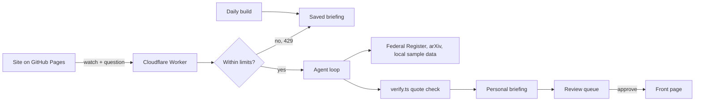

# My Newsren

A personal news research agent. Readers follow topics, organizations and questions; the agent returns a briefing built from human reporting and primary documents, each quoted and linked, plus a list of what it could not verify. The optional Ground Level lens traces national stories to one county.

- Site: https://gygooden.github.io/Newsren/
- Research Worker: https://newsren-agent.newsren-demo.workers.dev

Graduate course proof of concept. All local news is fictional sample data.

## Why

The Medill State of Local News 2026 report found 170 newspapers closed or merged in the past year and 7,500 newspaper jobs lost between 2024 and 2025 ([Truthout](https://truthout.org/articles/the-entire-journalism-industry-is-on-a-collision-course-with-ai/)). A University of Maryland study of 186,000 articles found more than 9% contain AI-generated text, and only 5 of 100 flagged articles disclosed it ([UMD](https://today.umd.edu/report-ai-use-in-newspapers-is-widespread-uneven-and-rarely-disclosed); see also [Forbes](https://www.forbes.com/sites/johnwerner/2026/10/23/ai-and-the-local-news/)).

My Newsren never writes news. It points readers to the people and documents that did the work.

## How it works

The agent has one goal, "Produce a grounded personal briefing for this watch", and five tools: `search_federal_register`, `search_arxiv`, `search_local`, `get_document` and `submit_briefing`. It plans its own searches until it submits or hits a limit.

Deterministic code then checks every claim: its quote must match text retrieved in the same run (similarity of at least 0.85), or it is removed and listed under "What we could not verify". Each briefing also includes:

- **Not yet reported:** primary documents with no news coverage, with a tip for a partner newsroom.
- **Beyond your watch:** one or two items outside your topics, chosen by a published significance score, never by engagement.

Live briefings are private and labeled "not editor-reviewed". Only stories approved in the review queue reach the front page.



## Limits

| Limit | Value |
| --- | --- |
| Live runs per visitor per day | 3 (salted IP hash, 24-hour expiry, raw IP never stored) |
| Live runs per day, all visitors | 50 |
| Per run | 6 steps, 8 tool calls, 1,200 tokens per call, 25,000 tokens total, 45 seconds |
| Input | 300-character questions, fixed topic and county lists |
| Origin | `https://gygooden.github.io` and `http://localhost:3000`, POST only |

Over a limit, the site shows the most recent saved briefing. A monthly spend limit in the Anthropic Console is the final safeguard. The model is `claude-haiku-5-5`.

## Course plan alignment

| Plan section | Where |
| --- | --- |
| 1. Agentic workflow | `lib/agent/orchestrator.ts`, `/about` |
| 2.1–2.6. My Newsren, grounding, story tools, impact, learning, alerts | `/watch`, `/briefing`, `/story/[id]`, `lib/agent/` |
| 3. Four sections | `/technology`, `/education`, `/industry`, `/finance` |
| 4. Finance guardrails | No-advice notice and filter (`labels.ts`, `verify.ts`) |
| 5. Navigation and "Explain for" | Header nav, "Follow a question", depth setting |
| 6. Components and human approval | `lib/agent/`, `/review` |
| 7, 9. Success measures and metrics | `scripts/eval.ts`, `docs/eval-results.md` |
| 8, 10. Positioning and summary | `docs/proposal.md` |

## Run locally

```sh
npm install
npm run ingest            # refresh Federal Register and arXiv snapshot
npm run dev               # http://localhost:3000
cd worker && npx wrangler dev
```

Copy `.env.example` to `.env.local` and `worker/.dev.vars.example` to `worker/.dev.vars`. Neither real file is committed.

Checks: `npm run lint`, `npm run typecheck`, `npm test`, `npm run test:e2e`, `npm run contrast`, `npm run eval`.

## Deploy

**Worker:** `cd worker`, then `npx wrangler secret put ANTHROPIC_API_KEY`, `npx wrangler secret put RATE_LIMIT_SALT`, `npx wrangler deploy`.

**Site:** pushes to `main` deploy through GitHub Actions, which also runs daily to refresh the data. The repository variable `NEXT_PUBLIC_AGENT_URL` holds the Worker URL, and Pages uses "GitHub Actions" as its source.

## Data and privacy

- **Federal Register:** public domain, via the [Federal Register API](https://www.federalregister.gov/developers/documentation/api/v1).
- **arXiv:** metadata is CC0, via the [arXiv API](https://info.arxiv.org/help/api/index.html). Thank you to arXiv for use of its open access interoperability.
- **Local news:** fictional sample data. Outlets, reporters and companies are marked "(sample)".
- **Images:** none from third parties. Icons are original SVG.

The site uses no accounts, cookies, analytics or tracking. Watches stay in your browser. Details are in [/privacy](https://gygooden.github.io/Newsren/privacy/) and [docs/accessibility.md](docs/accessibility.md) (WCAG 2.2 AA target).

## Future work

SEC EDGAR (which requires a declared contact), licensed local news, accounts, real-time alerts and a shared review queue.

## License

MIT
