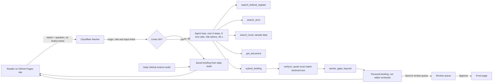

# My Newsren

## What this is

My Newsren is a personal news research agent built for a graduate course. A reader follows topics, organizations and questions, and the agent returns a briefing made of human reporting and primary documents, each quoted and linked, with a list of what it could not verify. An optional Ground Level lens traces national stories to one county and shows local documents that no journalist has covered yet.

Live site: [add GitHub Pages URL]. Research Worker: [add Worker URL].

This is a proof of concept. All local news in it is fictional sample data.

## Why it matters

Local reporting is shrinking. According to the Medill State of Local News 2026 report, as summarized by Truthout, 170 newspapers closed or merged in the past year, nearly three a week, and 7,500 newspaper jobs were lost between 2024 and 2025 ([Truthout, Oct 24, 2026](https://truthout.org/articles/the-entire-journalism-industry-is-on-a-collision-course-with-ai/)).

At the same time, AI text is entering newspapers without disclosure. A University of Maryland study of 186,000 articles from 1,500 U.S. newspapers found that more than 9% of articles contain at least some AI-generated text. Of 100 flagged articles checked by hand, five disclosed AI use ([UMD](https://today.umd.edu/report-ai-use-in-newspapers-is-widespread-uneven-and-rarely-disclosed)). Forbes has also discussed how AI is changing local news ([Forbes, Oct 23, 2026](https://www.forbes.com/sites/johnwerner/2026/10/23/ai-and-the-local-news/)).

My Newsren takes the opposite approach to AI-written news. The agent never writes stories. It points readers to the people and documents that did the work.

## How it works

### Principles

- Human journalism and primary documents are the product. Each item leads with the source, author, title, a short quoted excerpt and a link to the original.
- Every claim is grounded. Each factual sentence must match an exact quote in a source retrieved during the same run. Claims that fail are removed and listed under "What we could not verify".
- Readers see what they did not know to look for. "Beyond your watch" adds one or two items outside the reader's topics, chosen by a published significance score, never by engagement.
- Editors stay in control. A live briefing goes only to the reader who asked for it, labeled "Personal briefing, not editor-reviewed". The front page shows only stories a person has approved.

### The agent loop

The goal is fixed: "Produce a grounded personal briefing for this watch." The model has five tools: `search_federal_register`, `search_arxiv`, `search_local`, `get_document` and `submit_briefing`. It plans its own searches until it submits or reaches a limit. The orchestrator in `lib/agent/orchestrator.ts` enforces the limits in code and records every step in a trace.

After submission, `lib/agent/verify.ts` checks every quote with deterministic code (normalized fuzzy matching, similarity of at least 0.85). Then `stories.ts` groups items by shared tags, `gaps.ts` finds primary documents with no coverage, and `beyond.ts` selects items outside the watch.

The same pipeline, without a model, builds the saved briefings during the daily build. Those are the default view and the fallback.



## Features and alignment with the course plan

| Plan section | Requirement | Where it is implemented |
| --- | --- | --- |
| Section 1 | Workflow and the definition of agentic: goal, tools, controlled loop, limits | `lib/agent/orchestrator.ts`, `lib/agent/limits.ts`, `/about` |
| 2.1 | My Newsren personal research agent | `/watch`, `/briefing`, `worker/src/index.ts` |
| 2.2 | Grounded claims with exact quotes | `lib/agent/verify.ts`, `components/ClaimList.tsx` |
| 2.3 | Story tools: connected stories and timelines | `lib/agent/stories.ts`, `/story/[id]` (Connected stories tab) |
| 2.4 | Industry Impact view, supported versus speculative | `/industry`, `lib/agent/labels.ts` |
| 2.5 | Learning support at a chosen depth | `/story/[id]` (Learn this topic tab), `lib/agent/learn.ts` |
| 2.6 | Following developments and alerts | `/story/[id]` (Follow developments tab); delivery is future work |
| Section 3 | Four sections and their editorial products | `/technology` (Research Paper Decoder), `/education` (Policy Impact Explorer, Education Evidence Checker), `/industry` (Industry Impact view), `/finance` (Regulation Watch, AI-in-finance reality check) |
| Section 4 | Finance guardrails | `components/FinanceNotice.tsx`, investment-advice filter in `lib/agent/labels.ts` and `verify.ts` |
| Section 5 | Navigation, "Follow a question" entry point, "Explain for", the four story tools | `components/SiteHeader.tsx`, `/`, `components/WatchForm.tsx`, `components/StoryTools.tsx` |
| Section 6 | Components and critical requirements: verification, coverage gaps, labels, human approval | `lib/agent/*`, `/review` |
| Section 7 | Build-first features and stage success measures | My Newsren built first; measures in `scripts/eval.ts` and `docs/eval-results.md` |
| Section 8 | Positioning | `docs/proposal.md` |
| Section 9 | Metrics | `scripts/eval.ts`, planned human evaluations in `docs/proposal.md` |
| Section 10 | Summary | `docs/proposal.md` |

Not implemented, and listed as future work: real-time alert delivery, a shared review queue, accounts, licensed local news, and SEC EDGAR.

## Running locally and deploying

Requirements: Node 22.

```sh
npm install
npm run ingest        # fetch Federal Register and arXiv snapshot, then build saved briefings
npm run dev           # site at http://localhost:3000
npm run build         # static export to out/
cd worker && npx wrangler dev   # Worker at http://localhost:8787
```

For local live research, copy `.env.example` to `.env.local` and `worker/.dev.vars.example` to `worker/.dev.vars`, then fill in your own key in `worker/.dev.vars`. Both real files are gitignored.

Checks:

```sh
npm run lint
npm run typecheck
npm test                       # Worker unit tests, no real key or network
npm run test:e2e               # builds with a base path, then Playwright + axe
npx tsx scripts/check-contrast.ts
npx tsx scripts/eval.ts
```

### Deploying the Worker

```sh
cd worker
npx wrangler kv namespace create LIMITS     # paste the id into wrangler.toml
npx wrangler secret put ANTHROPIC_API_KEY
npx wrangler secret put RATE_LIMIT_SALT     # any long random string
npx wrangler deploy
```

Set `ALLOWED_ORIGIN` in `worker/wrangler.toml` to your GitHub Pages origin (for example `https://your-name.github.io`) before deploying.

### Deploying the site

1. In the repository settings, under Pages, set the source to "GitHub Actions".
2. Under Settings, Secrets and variables, Actions, Variables, add `NEXT_PUBLIC_AGENT_URL` with your Worker URL. It is public, not a secret.
3. Push to `main`. The workflow in `.github/workflows/deploy.yml` also runs daily and can be started by hand.

### Spend limit

Set a monthly spend limit in the Anthropic Console. It is the final safeguard if every other limit fails.

## Limits and cost controls

The Worker enforces these on every live run:

- Origin: requests are accepted only from `ALLOWED_ORIGIN`. POST only, with correct CORS preflight.
- Per visitor: 3 live runs per day, keyed by a salted SHA-256 hash of the IP address and date. Only the hash is stored, with a 24-hour expiry.
- Global: 50 live runs per day.
- Per run: at most 6 model steps, 8 tool calls, 1,200 output tokens per model call, 25,000 total tokens, and 45 seconds.
- Input: questions of at most 300 characters, topics from an allowlist, counties from a fixed list.

Over a limit, the Worker returns HTTP 429 and the site shows the most recent saved briefing with the message "Today's live research limit has been reached. Showing the most recent saved briefing."

The default model is `claude-haiku-5-5`, set in `worker/wrangler.toml`. Estimated cost per run is computed from the token counts in `lib/agent/limits.ts`. Check current prices on the [Anthropic pricing page](https://www.anthropic.com/pricing).

## Privacy and accessibility

There are no accounts, cookies, analytics, tracking scripts, third-party fonts or location requests. Watches stay in the browser's local storage. The Worker does not log request bodies and sends the model only the watch fields, the question and retrieved source text. The full policy is on `/privacy`.

The site targets WCAG 2.2 AA. See `docs/accessibility.md` for what was checked and how.

## Data and copyright

- Federal Register documents are U.S. government works in the public domain. They are fetched from the [Federal Register API](https://www.federalregister.gov/developers/documentation/api/v1).
- arXiv metadata is CC0. It is fetched from the [arXiv API](https://info.arxiv.org/help/api/index.html), with at most 10 results per request and at least 3 seconds between requests. Thank you to arXiv for use of its open access interoperability.
- Local news is sample data. Outlets and reporters marked "(sample)" are fictional, and so are the companies and institutions in those records. Real county names are used with fictional details.
- There are no third-party images. All icons are original inline SVG (see `docs/assets.md`).
- Requests use the generic User-Agent `newsren-course-demo`.

## Limitations and future work

- SEC EDGAR filings would strengthen the finance section. The SEC requires a declared contact in the User-Agent, so it is left out of this public demo.
- Licensed local news partnerships would replace the sample data.
- Accounts would allow saved watches across devices.
- Real-time delivery of alerts.
- A shared review queue for a newsroom, replacing the per-browser queue.
- Quote matching confirms that words appear in a source, not that a claim represents them fairly. Editors still need to read the originals.

## Sources

- Medill State of Local News 2026, via Truthout, Oct 24, 2026: https://truthout.org/articles/the-entire-journalism-industry-is-on-a-collision-course-with-ai/
- University of Maryland, report on AI use in newspapers: https://today.umd.edu/report-ai-use-in-newspapers-is-widespread-uneven-and-rarely-disclosed
- Forbes, AI and the local news: https://www.forbes.com/sites/johnwerner/2026/10/23/ai-and-the-local-news/
- Federal Register API: https://www.federalregister.gov/developers/documentation/api/v1
- arXiv API: https://info.arxiv.org/help/api/index.html

## License

MIT. See `LICENSE`.
